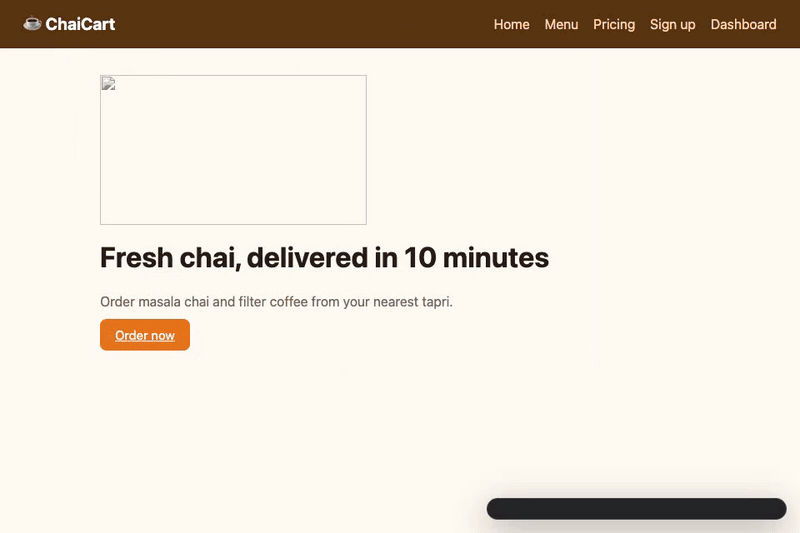
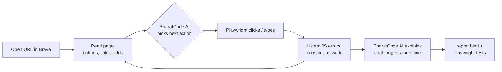

# Jaanch 🔍

[](https://github.com/Ajay702/jaanch/actions/workflows/ci.yml)   

**An AI tester that uses your web app like a real person, finds what breaks, tells you how to fix it, and writes the tests for you.**

Jaanch (जाँच, Hindi for *inspection*) opens your site in **Brave** with **Playwright**, clicks buttons, fills forms and moves between pages. **BharatCode AI** decides what to try next and explains every bug it finds.

```bash
npx github:Ajay702/jaanch http://localhost:3000
```



<sub>Real run on the included ChaiCart demo with BharatCode `qwen-3.8-27b`. Waiting time for the model is cut out; everything else is real speed ×1.8.</sub>

```
Jaanch v0.1.0  — testing http://localhost:4173
  brain: BharatCode AI (qwen-3.8-27b) · up to 30 actions

◆ /menu “Menu · ChaiCart”
   3/30 AI click button "Add Filter Coffee"
       ✖ TypeError: Cannot read properties of undefined (reading 'toFixed')
◆ /signup “Sign up · ChaiCart”
  11/30 AI click button "Create account"
       ✖ TypeError: Cannot set properties of null (setting 'textContent')
  12/30 AI click link "Dashboard"
       ✖ GET /api/orders returned 500

Found 4 high, 2 medium, 2 low across 5 pages in 13.5s
  📄 Report: jaanch-report/report.html
  🧪 Tests:  jaanch-report/jaanch.spec.js
```

## Why

Writing end-to-end tests is the chore every team skips. So bugs like a typo'd element ID, a button wired to a function that doesn't exist, or an API that 500s only show up when a real user hits them.

Code reviewers (human or AI) read your **code**. Jaanch **uses your app**, so it catches the bugs that only appear at runtime.

## What you get

| | |
|---|---|
| 🧭 **Explores on its own** | Follows links, clicks every button and fills forms with realistic Indian test data (names, +91 numbers, PIN codes). |
| 🐞 **Catches real bugs** | JavaScript crashes, console errors, failed API calls (4xx/5xx), broken pages and images, unclickable buttons. |
| ♿ **Accessibility checks** | Images without alt text, inputs without labels, buttons without names. |
| 🧠 **Explains the fix** | BharatCode AI reads the error **and the source line it came from**, then writes the cause and a concrete fix. |
| 🧪 **Writes Playwright tests** | One test per bug. It fails while the bug exists and passes once you fix it, so the bug can't come back. |
| 📄 **Shareable report** | `report.html` with screenshots, repro steps and the full journey, plus `report.json` for tooling. |
| 🛡️ **Safe by default** | Never clicks *Delete*, *Log out*, *Pay now*, *Unsubscribe* and the like, and never leaves your domain. |

## Quick start

**Requirements:** Node 20.12+ and Brave (Chrome or Edge also work).

```bash
# 1. Try it on the built-in demo shop with planted bugs
git clone https://github.com/Ajay702/jaanch && cd jaanch && npm install
npm run demo -- --watch          # watch Brave click around by itself

# 2. Point it at your own app
npx github:Ajay702/jaanch http://localhost:3000
```

### Turn on the AI brain

Without a key Jaanch still works, using built-in rules. With a [BharatCode](https://bharatcode.ai/build) key it explores smarter and writes much better explanations:

```bash
npm run set-key        # paste your key from https://bharatcode.ai/account (hidden input, saved to .env)
npx github:Ajay702/jaanch --check-ai            # ✔ BharatCode AI works (qwen-3.8-27b): नमस्ते
```

Students get free access (Qwen, 10M tokens a day). A full 25-step run on the demo shop uses about 20 model calls and roughly 12k tokens.

## Options

```
jaanch <url> [options]

  -s, --steps <n>        Max actions to try (default 25)
  -w, --watch            Show the browser while it works, with a live HUD
  -r, --record <file>    Save a video of the run (.webm), HUD included
  -o, --out <dir>        Report folder (default ./jaanch-report)
  -t, --tests <file>     Where to write Playwright tests
  -b, --browser <name>   brave | chrome | edge (default brave)
      --no-ai            Rules only, no model calls
      --fail-on <level>  Exit 1 on bugs of this severity or worse (for CI)
      --open             Open the report when done
      --check-ai         Test your BharatCode key
```

### Use it in CI

```yaml
- run: npm start &                      # start your app
- run: npx github:Ajay702/jaanch http://localhost:3000 --fail-on high
  env:
    BHARATCODE_API_KEY: ${{ secrets.BHARATCODE_API_KEY }}
- uses: actions/upload-artifact@v4
  if: always()
  with: { name: jaanch-report, path: jaanch-report }
```

## How it works



1. **See.** Every visible link, button and field is listed and tagged.
2. **Decide.** Jaanch builds a safe shortlist (fill empty fields, then submit, then untried buttons, then new pages), with dangerous actions already removed. BharatCode's `qwen-3.8-27b` picks one and writes realistic input. Without AI, the first item on the shortlist wins.
3. **Act and listen.** Playwright performs the action while Jaanch records page errors, console errors and failed requests, each tied to the exact step that caused it.
4. **Explain.** For each bug, Jaanch fetches the source lines around the error and asks the model for a title, severity, what the user sees, the root cause and a fix, using structured JSON output.
5. **Lock it in.** Each bug becomes a Playwright test that replays the steps on that page and asserts the bug is gone.

### How BharatCode is used

- **Endpoint:** `https://bharatcode.ai/api/model/v1/responses` (OpenAI-compatible Responses API)
- **Model:** `qwen-3.8-27b` (override with `JAANCH_MODEL`)
- **Structured output:** `text.format: json_schema`, so every answer is validated JSON, never scraped prose
- **Resilient:** retries 503 "model busy" with backoff, detects cut-off output, falls back to rules if the model is unreachable, and never blocks a run

## Project layout

```
bin/jaanch.js      CLI entry
src/browser.js     finds Brave/Chrome/Edge, launches via Playwright
src/explorer.js    the see → decide → act loop
src/planner.js     safe action shortlist + BharatCode planner
src/collector.js   turns browser events into deduped issues
src/analyze.js     severity + AI explanations with source context
src/testgen.js     Playwright regression test generator
src/report.js      HTML + JSON report
demo/              ChaiCart, a demo shop with 6 planted bugs
```

## Development

```bash
npm test          # unit tests + an end-to-end run against the demo shop
npm run demo      # run Jaanch on ChaiCart
```

## Roadmap

- Log in first using a saved Playwright `storageState`
- Mobile viewport and slow-3G runs
- Comment the report on GitHub pull requests
- Visual regression (screenshot diffs between runs)

## License

MIT · Built for the **BharatCode Build League 2026** by [Ajay Raghav](https://github.com/Ajay702).
